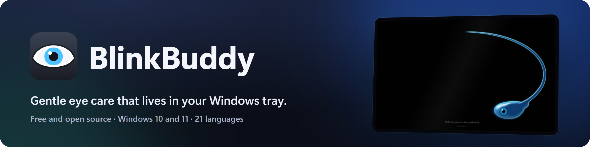

<picture>
  <source media="(prefers-color-scheme: dark)" srcset="docs/media/banner-dark.png">
  <source media="(prefers-color-scheme: light)" srcset="docs/media/banner-light.png">
  
</picture>

Blink reminders, breaks your eyes can follow, a warmer screen at night and a strip to read by.

  
  
  
  
  

  

## Features

<table>
  <tr>
    <td width="50%" valign="top">
      
      <h3>Blink reminders</h3>
      A little eye peeks out of the corner and blinks with you, or two soft eyelids sweep over the screen once.
    </td>
    <td width="50%" valign="top">
      
      <h3>Screen filter</h3>
      Warmer light after sunset, wherever you are. Dimmer than your display goes. Grayscale, sepia, e-ink and red night.
    </td>
  </tr>
  <tr>
    <td width="50%" valign="top">
      
      <h3>Reading strip</h3>
      Everything but the line you're reading dims softly, and the strip follows you down the page.
    </td>
    <td width="50%" valign="top">
      
      <h3>Mini mode and focus timer</h3>
      A small eye floats over your work: point at it for the essentials, or let it count down your focus time.
    </td>
  </tr>
  <tr>
    <td width="50%" valign="top">
      
      <h3>21 languages, Simple or Advanced</h3>
      Picked up from Windows, with every spoken step in your language. Calm by default, every detail when you want it.
    </td>
    <td width="50%" valign="top">
      <h3>And also</h3>
      <ul>
        <li><b>Guided breaks</b> every 20 minutes and a <b>stretch coach</b> every hour, read aloud if you like</li>
        <li><b>Tone</b> that calms bright areas and keeps dark details readable</li>
        <li><b>Modes</b> for reading, movies or editing, and a mode per app that switches by itself</li>
        <li>The display's <b>real backlight</b>, film grain, keyboard shortcuts, keeping the PC awake</li>
        <li><b>Keyboard and Narrator</b> friendly, with dark title bars and menus</li>
      </ul>
    </td>
  </tr>
</table>

## Calm, and out of your way

Everything in one quiet window, and the essentials a point away in mini mode.

## Light by design

- **About 3 MB of memory** while it waits in the tray, and a 1.4 MB program.
- **No administrator rights** to install or run, and **nothing else to install**: no .NET, no runtime.
- **Works offline.** No account, no ads, no analytics. See [privacy](PRIVACY.md).
- **Native on Arm PCs** too (Snapdragon laptops), with an ARM64 build of every download.

## Install

1. Download **`Softlid-<version>-setup.exe`** from the [latest release](https://github.com/Kindleshard/Softlid/releases/latest)
   (on an Arm PC, the `-arm64-setup.exe`).
2. Run it, and choose whether the spoken steps come in just your language (about 2 MB installed in all) or all 21.
3. Softlid starts in the tray, by the clock, with a short tour the first time.

Prefer no installer? The `-portable.zip` runs from any folder. Softlid needs Windows 10 or 11, 64-bit.

> **"Windows protected your PC"?** Softlid isn't code-signed yet, so Windows SmartScreen doesn't know it. Click
> **More info**, then **Run anyway**. Each release lists the checksums of its files.

## FAQ

<b>Is it really free?</b>

Yes, and open source under the MIT license. If it helps you, you can
[buy it a coffee on Ko-fi](https://ko-fi.com/P2Z229LS9G).

<b>Does it work with Windows Night light?</b>

Yes. Softlid can follow Night light's schedule (**Sync with Windows Night light**), or keep its own: sunset to
sunrise where you are, or hours you choose.

<b>Will it slow my PC down?</b>

No. Waiting in the tray it uses about 3 MB of memory and next to no processor time, and Options > Resource use shows
exactly what it uses right now.

<b>How do I update or uninstall it?</b>

Options > Updates checks for new versions and installs them in place. To uninstall, use Windows Settings > Apps >
Installed apps > Softlid. Your settings stay in `%AppData%\Softlid`, in case you come back.

<b>Wasn't this called BlinkBuddy?</b>

Yes, until version 1.1.0: another eye care app already had that name. Updating from BlinkBuddy keeps your settings.

<b>Something isn't working</b>

Options > Help and support > **Report a bug** opens a form here with your version and Windows filled in. Or
[open an issue](https://github.com/Kindleshard/Softlid/issues/new/choose) directly.

## Support

Found a bug or have an idea? [Open an issue](https://github.com/Kindleshard/Softlid/issues). What changed in each
version: [CHANGELOG.md](CHANGELOG.md). Building it yourself,
or curious how it works: [cpp/docs/BUILDING.md](cpp/docs/BUILDING.md).

## Where the downloads come from

Every download is built from this repository's source by
[GitHub Actions](https://github.com/Kindleshard/Softlid/actions/workflows/release.yml), and each release page shows
every file's SHA-256 next to it. The releases aren't code-signed yet.

Privacy policy: [PRIVACY.md](PRIVACY.md). Softlid collects no personal data; it goes online only to check for
updates (which can be switched off) and when you ask it to.

## License

[MIT](LICENSE). The spoken steps were made with Chatterbox Multilingual (MIT) and, for Czech, Hungarian, Romanian and
Ukrainian, Piper voices under their own licenses; see [credits](cpp/res/voice/CREDITS.txt).
