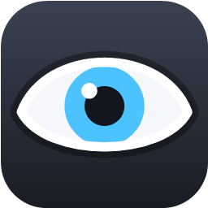
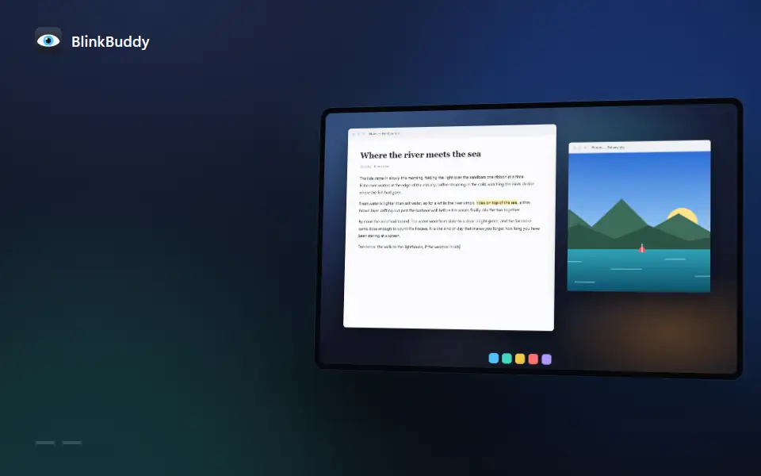
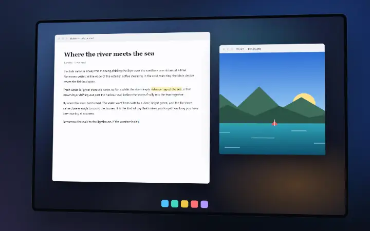
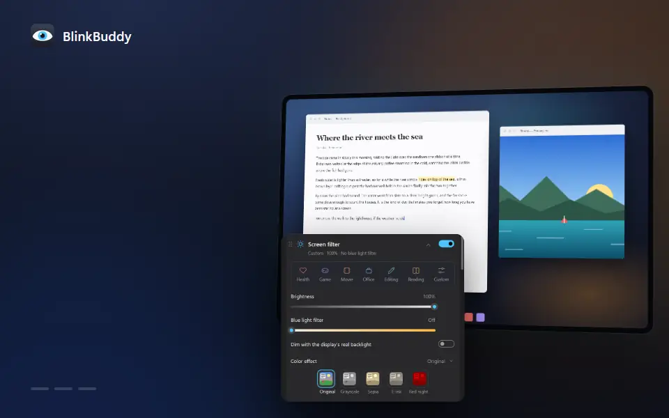
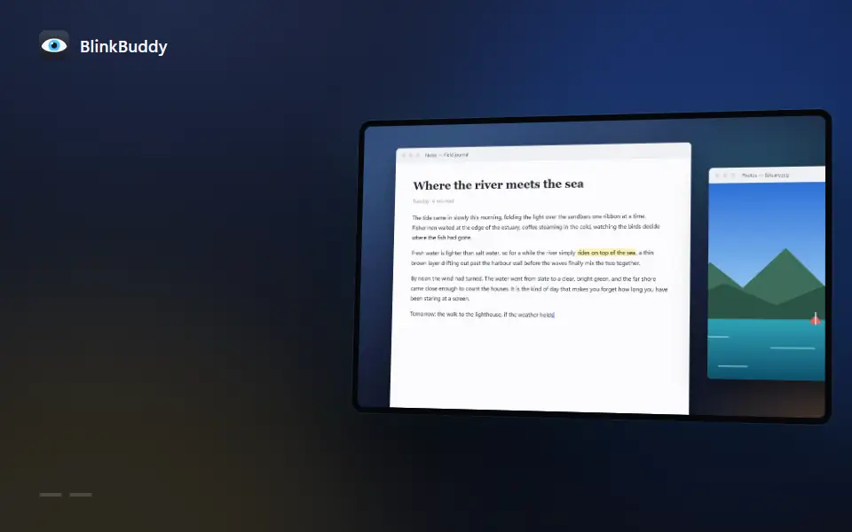
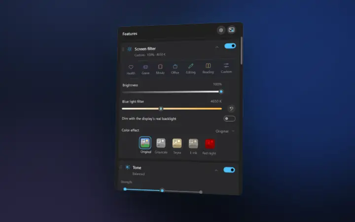

<p align="center"></p>

<h1 align="center">BlinkBuddy</h1>

<p align="center"><b>Gentle eye care that lives in your Windows tray.</b><br>
Blink reminders, breaks your eyes can follow, a warmer and dimmer screen at night, and a strip to read by.<br>
Free, in 21 languages, and light: about 3 MB of memory while it waits.</p>

<p align="center"></p>

## A closer look

**Blink reminders.** A little eye peeks out of the corner and blinks with you, or two soft eyelids sweep over the
screen once.



**Screen filter.** Warmer light after sunset, brightness below what your display allows, and colour effects.



**Reading strip.** Everything but the line you're reading dims, and the strip follows you down the page.



**Mini mode and the focus timer.** A small eye floats over your work: point at it for the essentials, or let it count
down your focus time.


**Your language, your level of detail.** 21 languages, and a Simple view that grows into an Advanced one.



The loops are made from the real app by the scripts in [cpp/tools/media](cpp/tools/media).

## Everything it does

- **Blink reminders**: a small eye that blinks with you, or soft eyelids across the screen.
- **Breaks**: look-away breaks every 20 minutes and stand-up breaks every hour. A break can be a simple card, guided
  eye exercises with a liquid eye to follow, or a stretch coach. The steps can be spoken.
- **Screen filter**: brightness below what the display allows, a blue light filter that follows sunset and sunrise
  where you are, colour effects (grayscale, sepia, e-ink, red night), invert, and the display's real backlight over
  DDC/CI.
- **Tone**: calms bright areas and deepens darks. The Standard engine works everywhere; the experimental engines are
  Smart (GPU), Smart layer and DesktopLUT. A visibility guard keeps dark details readable, and a test lab compares
  them all.
- **Modes and app rules**: one-click modes (Reading, Movie, Editing, ...), and a mode per app that switches when that
  app comes to the front.
- **Extras**: a reading strip that dims everything but the line you read, a focus timer, film grain, mini mode (a
  small icon that stays on top), keyboard shortcuts, and keeping the PC awake.
- **21 languages**, a Simple and an Advanced view, and dark title bars and menus.

Settings are kept in `%AppData%\BlinkBuddy\settings.ini`.

## Getting it

Nothing is published yet. To get BlinkBuddy, build it yourself (below).

- **Installer** (`BlinkBuddy-<version>-setup.exe`): installs for your user only, with no administrator rights, into
  `%LocalAppData%\Programs\BlinkBuddy`. It asks whether the spoken steps should come in just your language (about
  2 MB installed in all) or all 21, adds a Start menu entry and can start BlinkBuddy when you sign in. Unattended,
  `/S /VOICES=all` or `/S /VOICES=tr` chooses. Uninstalling keeps your settings.
- **Portable** (`BlinkBuddy-<version>-portable.zip`): unzip anywhere and run `BlinkBuddy.exe`. The `voice` folder
  next to it holds the spoken break steps; without it, Windows' own voice reads them.

It needs Windows 10 or 11, 64-bit. There is nothing else to install: the C runtime is built into the exe. For ARM64
PCs (Snapdragon and other Arm laptops) each download has an `-arm64` twin, built for them; the regular one runs there
too, through Windows' emulation.

## Building

BlinkBuddy is written in C++ and Direct2D, in `cpp/`. (It began in C#, .NET Framework 4.8; that version, which the
rewrite was checked against, is in the history up to commit 06cbb8a.)

You need Visual Studio 2022 or its Build Tools, with the "Desktop development with C++" workload.

```bash
powershell -ExecutionPolicy Bypass -File cpp/build.ps1
```

`build.ps1` puts `BlinkBuddy.exe` and its `voice` folder in `cpp/bin/`. It also builds and runs the tests (`cpp/tests`: the core logic, the tone pipeline's decisions, settings, shortcuts and the Night light reader); a failing test stops the build. `build.ps1 -Arch arm64` builds for ARM64 PCs into `cpp/bin-arm64/` (with Visual Studio's ARM64 tools, "MSVC ARM64 build tools"; on an x64 PC its tests are built but can't run).

To check that a change leaves the settings window looking exactly as before, `cpp/tools/ui-check.ps1 -Update` saves a
baseline of every view (each tab, scrolled through to its end) and `cpp/tools/ui-check.ps1` compares against it, pixel by
pixel. It runs a diagnostic copy (`--offscreen --settings <file>`) beside a running BlinkBuddy, with settings of its
own, so nothing of yours is touched.

```bash
powershell -ExecutionPolicy Bypass -File cpp/release.ps1
```

`release.ps1` makes a release in `cpp/dist/`, for x64 and (with the ARM64 tools) ARM64: the exe on its own, the portable zip and, if
[NSIS 3](https://nsis.sourceforge.io) is installed (or unzipped into `C:\Tools\nsis`), the installer from
`cpp/installer/BlinkBuddy.nsi`. Nothing is uploaded.

The version number lives in `cpp/res/BuildVersion.h`. Two constants in `cpp/src/core/Version.h` turn on the parts
that need somewhere to point:

- `ReleaseRepo` (`owner/name` on GitHub): **Options > Check for updates** and the weekly check look at that repo's
  latest release. A newer `BlinkBuddy.exe` attached to it is downloaded, swapped in and restarted. Until it is set,
  the Options page says there is no release channel.
- `DonateUrl`: shows a **Support...** button on the Options page.

Diagnostics:

- `--offscreen` opens the settings off the screen, for screenshots; with `--no-screen` that copy leaves the screen
  filter and tone off the screen, and with `--tray` it starts quietly (mini mode shows, if it's on).
- `--ui-gallery` shows every control (debug builds only: `build.ps1 -Debug`).
- `--preview-break`, `--preview-exercises`, `--preview-stretch` and `--preview-blink` show those once; `--settings
  <file>` gives them settings of their own.

The README's loops are made in `cpp/tools/media` (Chrome and ffmpeg needed): `record.ps1` films BlinkBuddy over a
staged desktop, `shot.ps1` captures its settings window off the screen, and `node render.mjs <loop>` renders a loop
from `loops/<loop>.html` into `docs/media/<loop>.webp`.

## What it connects to

- GitHub, only for the update check: while automatic checks are on, once a week and when you open Options; or
  when you click Check for updates.
- GitHub, to download DesktopLUT, only when you choose "Download and set up".
- Windows location, only for the sunset-to-sunrise schedule, a few times a day.

Nothing else leaves the PC. The details are in [PRIVACY.md](PRIVACY.md).

## Memory

Measured on Windows 11 at 150% scaling. Private memory is what the app itself uses.

| | Tray, idle | Settings open |
|---|---|---|
| C# version | 24.6 MB | — |
| C++ version 1.0.0 | 2.9 MB | 10.2 MB |
| C++, one shared drawing device | 1.9 MB | 13.1 MB |

The last row is measured with the window on the monitor; the rows above it measured a window kept off the screen,
which Windows hardly paints, so their "Settings open" figures are too low (the same build measured on the monitor:
16.5 MB). Left alone for a few seconds, the open settings window gives its pages back to Windows: about 0.6 MB of
its own in RAM; mini mode does the same once its icon is still (0.4 MB). When the settings close, the working set
drops back to about 1 MB. Details for every step of the rewrite are in [cpp/docs/MEMORY.md](cpp/docs/MEMORY.md).

## DesktopLUT

The DesktopLUT tone engine uses [DesktopLUT](https://github.com/sup3rflyer/DesktopLUT), a separate free program
that applies a colour table inside Windows. BlinkBuddy only starts, watches and stops it, with a small helper that
runs as administrator. Every safeguard stops DesktopLUT and puts BlinkBuddy's own filter back:

- a 15-second check after switching on (and after each Windows update)
- a watchdog for crashes
- the panic key **Ctrl+Alt+Shift+L**

## License

BlinkBuddy is free and open source, under the [MIT License](LICENSE). The spoken steps were made with Chatterbox
Multilingual (MIT) and, for Czech, Hungarian, Romanian and Ukrainian, Piper voices under their own licences: see
[cpp/res/voice/CREDITS.txt](cpp/res/voice/CREDITS.txt).
